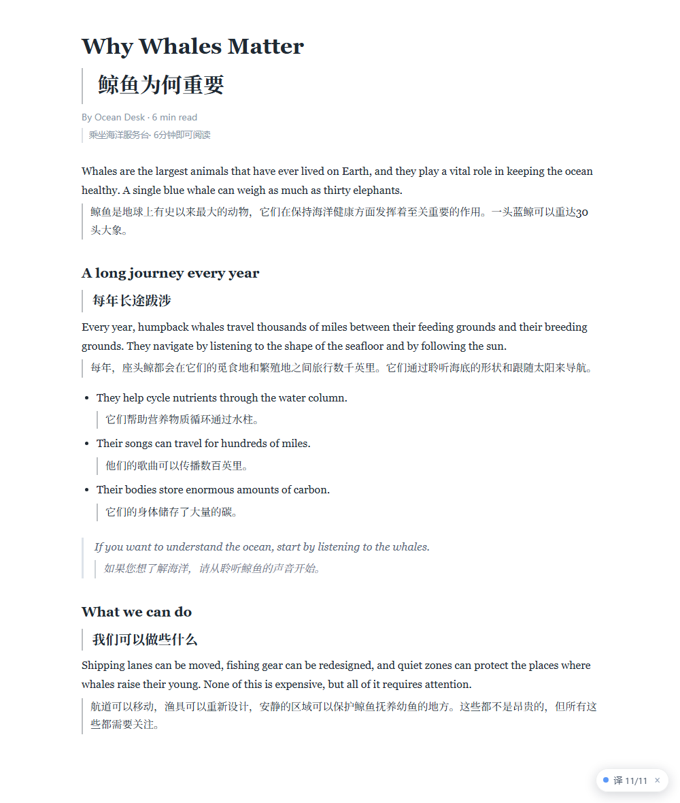
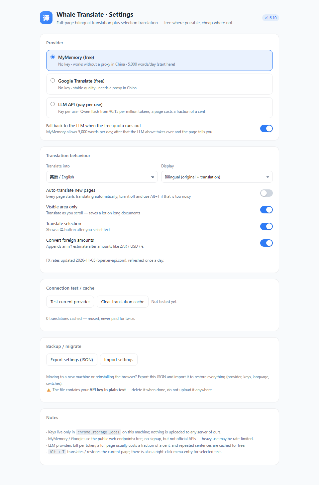
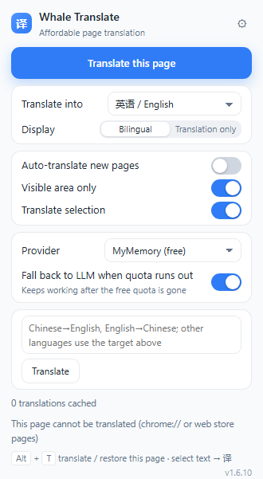

[中文](README.md) · **English**

# Whale Translate · cheap page translation

A Chrome / Edge extension for **bilingual full-page translation** and **selection translation**. The default provider needs no API key, no signup, and works in China without a proxy; switch to a cheap OpenAI-compatible LLM (DeepSeek, Qwen, GLM, …) when you want better quality.

<p>
  
  <br /><br /><br /><br /><br /><br /><br /><br /><br /><br /><br /><br />
  Hand-built by <strong>大肥鱼</strong> · feedback welcome · deepdeep
</p>

## What it does

- **Bilingual full page** — original text stays, translation appears below it with a left border
- **Translation only** — hide the original and read just the translated text
- **Selection translation** — select text, click the 「译」 bubble, get a card you can copy
- **Right-click translate** — select text → right click → “Whale Translate: …”
- **Visible area only** — translate as you scroll, which cuts the cost of long documents
- **Local cache** — the same sentence is only paid for once, across pages
- **Automatic fallback when the free quota runs out** — MyMemory gives 5,000 words/day; when it is gone the extension switches to your LLM, tells you on the page, and switches back the next day
- **Switch provider from the popup** — MyMemory / Google / LLM, plus the fallback switch, without opening the options page
- **Translate text in the popup** — paste a paragraph, press Translate (or Enter), no page needed
- **Keys are stored per host** — your DeepSeek key is only ever sent to DeepSeek
- **Currency conversion** — amounts like `ZAR 300K` or `$1,200` get an `≈¥` estimate appended
- **Does not translate what it should not** — code blocks, inputs and already-Chinese paragraphs are skipped
- Auto-translate toggle, 9 target languages, `Alt + T` / `Alt + Q` shortcuts
- **UI follows your browser language**: Chinese / English / French — and unless you pick a target, it defaults to your system language



## Install (30 seconds)

1. Open `chrome://extensions` (`edge://extensions` on Edge)
2. Turn on **Developer mode** (top right)
3. Click **Load unpacked** and pick this folder (the one containing `manifest.json`)
4. **Reload** any page that was already open — old tabs do not have the content script yet

> It is not on the Chrome Web Store yet, so this is the only install path. The extension never talks to any server of ours.

## Usage

| Action | Result |
| --- | --- |
| Toolbar icon → “Translate this page” | Translate the whole page |
| Click again (or `Alt + T`) | Restore the original |
| Select text → click 「译」 | Selection translation card |
| Select text → right click → “Whale Translate” | Same, via the context menu |
| Paste text in the popup → Translate | Chinese→English, English→Chinese, Enter to translate |
| Icon → ⚙ | Settings: provider, language, mode, auto-translate |



The popup:



## Which provider is cheapest

| Provider | Key needed | Cost | Works in China | Good for |
| --- | --- | --- | --- | --- |
| **MyMemory (default)** | no | free, ~5,000 words/day | ✅ | news, docs, casual reading |
| **Google Translate** | no | free | ❌ needs a proxy | steadier quality if you have one |
| **LLM API** | yes | per token, a fraction of a cent per page | ✅ | long texts, papers, daily use |

The default MyMemory is the public `api.mymemory.translated.net` endpoint: no signup, works right after install. It is a translation-memory service, so very long or highly technical sentences can be mediocre.

**For better quality**, choose “LLM API” in settings, pick a preset (DeepSeek / Qwen / Zhipu GLM / Xiaomi MiMo / SiliconFlow / local Ollama) and paste the matching `sk-...` key.

### LLM price comparison (official prices, Oct 2026 — they change)

| Provider | Model | Input | Output | Per 5,000-char page |
| --- | --- | --- | --- | --- |
| Qwen | `qwen-flash` | ¥0.15/M (≈$0.02) | ¥1.5/M (≈$0.21) | **≈¥0.003** |
| Xiaomi MiMo | `mimo-v2.6-flash` | ¥1.00/M (≈$0.14) | ¥2.00/M (≈$0.28) | ≈¥0.006 |
| DeepSeek | `deepseek-flash` | ¥1.1~2.1/M (≈$0.15~0.3) | ¥4.3~8.5/M (≈$0.6~1.2) | ≈¥0.01 |
| Zhipu | `glm-5.3-flash` | see official site | see official site | free tier available |

> DeepSeek bills in USD ($0.15~0.3 / $0.6~1.2 per million); the table converts at **$1 ≈ ¥7.1**, so check the official site for the exact number.
>
> Model names change often (DeepSeek is `deepseek-flash` now, MiMo moved from V2.5 to V2.6). If a preset is wrong, edit the fields manually.

### Quota fallback

On by default. MyMemory allows 5,000 words per day; the moment it runs out:

1. the batch being translated **switches to your LLM immediately**, without failing
2. a toast appears in the bottom-right corner of the page
3. until midnight everything goes through the LLM, so it does not keep hitting the free endpoint
4. the next day it switches back to MyMemory automatically

The options page shows an orange banner with a “Switch back to free now” button, and the popup shows the reset time. Do not want to spend? Turn “Fall back to LLM when quota runs out” off — then quota errors are shown directly.

MyMemory sometimes returns HTTP 429 (too many requests); the extension **waits 1.6 s and retries once**, and only then treats it as an exhausted quota. Requests are spaced at least 300 ms apart.

Without a configured key there is no fallback — you just get the error, so nothing is spent silently.

### Currency conversion

On by default. Any foreign amount in the translation (`ZAR 300K`, `$1,200`, `€500`, `20M`) gets a CNY estimate appended:

```
Design budget: 300,000 ZAR (≈¥121,000)
Project budget: 20,000,000 ZAR (≈¥8,039,000)
```

- Rates come from [open.er-api.com](https://open.er-api.com/) (free, no key) and are **refreshed every 24 hours**
- Conversion happens **locally**; no extra translation call, no extra tokens
- Recognises ISO codes, English/Chinese names and symbols (`$ € £ ₽ ₩ ₹`), with `K/M/B` multipliers
- CNY amounts are left alone, and already-converted text is not converted twice
- If rates cannot be fetched, it quietly skips — no made-up numbers
- Turn it off in settings and nothing is converted

A failed paragraph no longer breaks the page: it waits 1.2 s and retries, then skips that paragraph and keeps going, with a note at the bottom of the page. If the LLM returns the wrong number of items, it splits the batch in half and retries.

## Shortcuts

**Both `Alt + T` (default) and `Alt + Q` (backup) work.**

There are two layers:

1. **Browser command** (`chrome.commands`) — works anywhere in the window, even from the address bar
2. **Page-level listener** — even if the browser command is not bound, focusing the page and pressing `Alt+T` / `Alt+Q` still works

If neither works:

- **Chrome window not focused** — click the page once
- **Another extension took the key** — open `chrome://extensions/shortcuts` and re-record it
- **`chrome://`, web store or PDF pages** — injection is not allowed; the toolbar icon flashes a red `!`
- **Pages opened before the extension was installed** — auto-injected since v1.6.3

The “Translate this page” button in the popup uses the same path, so if the button works, the extension is fine.

## Where the savings come from

1. **Visible area only** (default): long articles only cost what you actually read
2. **Cache**: keyed by `provider + target language + source text`, so a sentence is never paid for twice
3. **Chinese paragraphs are skipped**, never translated again
4. **Code blocks, inputs and `translate="no"` are untouched**
5. **Paced batches** (130–260 ms) to avoid 429s on the free endpoints
6. **Quota fallback** so a translation never dies halfway through

## Sharing it

Send `dist/whale-translator-v1.6.10.zip` (or the file from the Releases page), then:

1. unzip it (you get a `whale-translator` folder with `manifest.json` at the top)
2. `chrome://extensions` → Developer mode → Load unpacked → pick that folder
3. reload the page

A few notes:

- the package contains **no API keys** — keys live only in each browser's local storage
- Chrome will show “Disable developer mode extensions”; click × and ignore it
- it asks for “Read and change all your data on all websites”, which any translation extension needs
- unpacked extensions do not auto-update; to update, replace the folder and click ⟳
- MyMemory's quota is per IP, so a shared network shares the limit — heavy users should configure an LLM key

### Updating without losing your key

Chrome derives the ID of an unpacked extension from its folder path, so moving the folder used to reset storage. Since v1.2.1 the manifest pins the `key` field, so the ID is always `gjahhlakjemgcdnoeehjjjaddjajhbka` — settings and keys survive folder changes.

### Backup / moving machines

Settings → **Export settings (JSON)** / **Import settings**:

- the export contains provider, keys, language and toggles
- ⚠️ the file contains your **API key in plain text** — delete it afterwards
- import only accepts whitelisted fields, so a broken JSON file cannot corrupt your settings

Moving to a new machine: export → copy the file → install → import.

## Known limitations

- `chrome://`, `edge://`, the web store and PDF viewer pages cannot be translated (the browser forbids injection)
- MyMemory is mediocre on long or technical sentences; use an LLM for important content
- The free endpoints are not official APIs and can change or disappear at any time
- Pages built entirely from absolutely-positioned divs can miss a few blocks — press `Alt + T` again after the page finishes loading

## Privacy

- Only the text being translated is sent, and only to the provider you selected
- API keys are stored locally in `chrome.storage.local`, one per provider host
- No analytics, no tracking, no server of our own

## Development

```bash
npm test               # 33 unit tests: cache, 400 fallback, item-count checks, quota fallback, key isolation
npm run test:browser   # headless browser: install → translate → check DOM → restore → selection → shortcuts
npm run test:fallback  # quota exhausted → LLM fallback → page notice → options state → switch back
npm run test:import    # export → real download → clear → import → verify
npm run test:package   # unpack the newest zip and load it again
npm run test:stable    # install from two folders, confirm the ID (and settings) survive
```

Browser tests need **Edge / Chromium / Chrome for Testing** (Chrome 137+ blocks `--load-extension`). The scripts find common paths automatically; override with `WT_BROWSER=/path/to/chromium`.

### Project layout

```
chrome-translator/
├─ manifest.json           # MV3 manifest
├─ src/
│  ├─ background.js        # service worker: providers, fallback, cache, pacing, menus, shortcuts
│  ├─ lib.js               # pure functions: settings merge, language checks, chunking, JSON, currency
│  ├─ content.js           # page side: block detection, batch translation, rendering, selection UI
│  ├─ i18n.js              # zh/en UI strings (popup and options follow the browser language)
│  ├─ popup.html/js        # toolbar panel
│  ├─ options.html/js      # settings page
│  └─ icons/
├─ tests/                  # unit + end-to-end
├─ tools/                  # changelog convertor, test runner
├─ docs/                   # screenshots and mascot
└─ .github/workflows/      # CI (Ubuntu/Windows × Node 22/24) and release-on-tag
```

## Releasing

Push a tag and CI builds and publishes the zip:

```bash
git tag v1.6.11
git push origin v1.6.11
```

`.github/workflows/release.yml` packages the extension, scans the archive for keys, and attaches it to a GitHub Release.

## License

MIT — see [LICENSE](LICENSE). Contributions welcome: [CONTRIBUTING.md](CONTRIBUTING.md).
