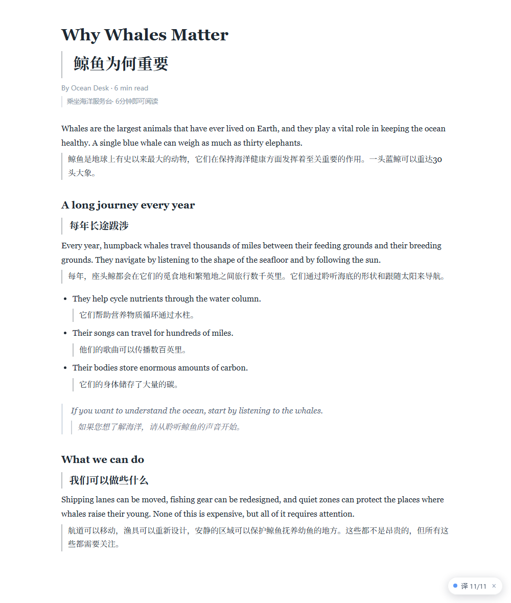
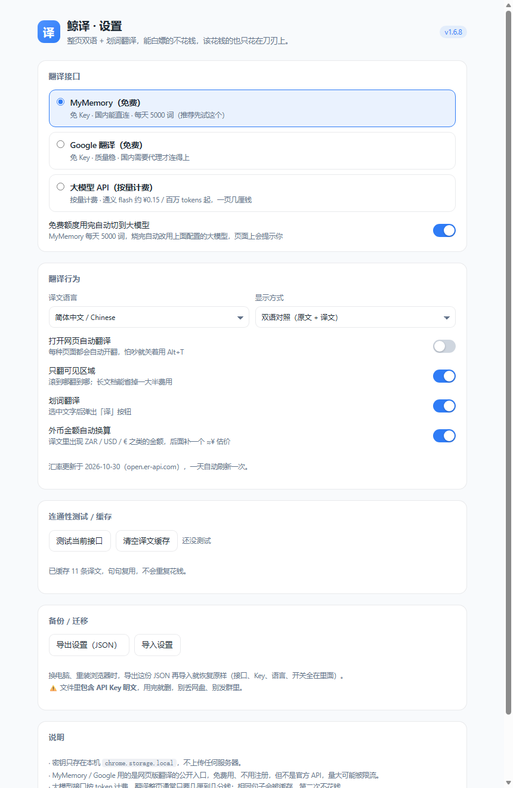
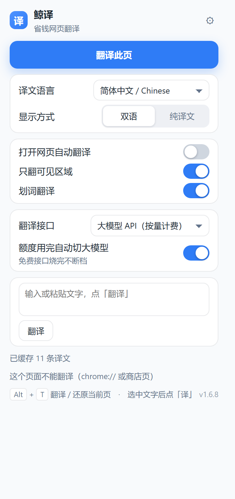

# 鲸译 · 省钱网页翻译

Chrome / Edge 扩展。整页双语对照 + 划词翻译，**默认接口免 Key、免注册、国内能直连**；想更准就换成 DeepSeek 这类便宜的兼容接口。



## 它做什么

- **整页双语**：英文网页一键翻，原文不动，译文跟在下边，带左边线区分
- **纯译文模式**：只看中文，原文自动收起
- **划词翻译**：选中一段，旁边冒出「译」字，点开就是译文卡片，可一键复制
- **右键翻译**：选中文字 → 右键 →「鲸译：翻译“…”」
- **只翻可见区域**：滚到哪翻到哪，长文档能省掉一大半费用
- **本地缓存**：同一句话只花一次钱，换页面也复用
- **免费额度用完自动兜底**：MyMemory 当天额度烧完，自动切到你配的大模型，页面会提示，第二天自动切回免费
- **弹窗里直接切接口**：MyMemory / Google / 大模型 随时换，兜底开关也在同一块，不用进设置页
- **弹窗里直接译文字**：粘贴一段话点「翻译」，不用开网页（回车即译）
- **Key 按服务商分开存**：DeepSeek 的 Key 只发给 DeepSeek，切到通义/智谱不会跟着跑
- **外币金额自动换算**：译文里出现 `ZAR 300K`、`$1,200` 这类金额，后面补一个 `（≈¥12.1万）`
- **不瞎翻**：代码块、输入框、已经是中文的段落直接跳过
- 自动翻译开关、9 种目标语言、`Alt + T` / `Alt + Q` 快捷键

## 安装（30 秒）

1. 打开 `chrome://extensions`（Edge 是 `edge://extensions`）
2. 右上角打开「**开发者模式**」
3. 点「**加载已解压的扩展程序**」，选这个文件夹（有 `manifest.json` 的那一层）
4. 装完**刷新**一下已经开着的网页 —— 老页面里没有内容脚本

> 没上架商店，所以只能这样装；扩展不会连任何自己的服务器。

## 怎么用

| 操作 | 效果 |
| --- | --- |
| 点工具栏图标 →「翻译此页」 | 整页翻译 |
| 再次点击（或 `Alt + T`） | 还原原文 |
| 选中文字 → 点「译」 | 划词翻译卡片 |
| 右键选中文字 →「鲸译」 | 同上，走菜单 |
| 弹窗里粘贴文字 →「翻译」 | 不进网页也能翻：中文→英文、英文→中文，回车即译 |
| 图标 → ⚙ | 设置：接口、语言、模式、自动翻译 |



工具栏小面板：



## 用哪个接口最省

| 接口 | 要 Key 吗 | 花钱吗 | 国内直连 | 适合 |
| --- | --- | --- | --- | --- |
| **MyMemory（默认）** | 不用 | 免费，约 5000 词/天 | ✅ | 随手看新闻、读文档 |
| **Google 翻译** | 不用 | 免费 | ❌ 需要代理 | 有梯子时质量更稳 |
| **大模型 API** | 要 | 按 token，几分钱一页 | ✅ | 长文、论文、天天用 |

**默认的 MyMemory** 是 `api.mymemory.translated.net` 的公开接口，不用注册，装完就能用。缺点是它本质是“翻译记忆库”，句子太长或太专业时质量一般。

**想又快又准**：设置页选「大模型 API」，上面的「快速选择服务商」里挑一个（DeepSeek / 通义千问 / 智谱 / 小米 MiMo / 硅基流动 / 本地 Ollama），把对应的 `sk-...` 粘进去就行。

### 大模型选哪家最省（价格按 2026-10 官网，会变）

| 服务 | 模型 | 输入 | 输出 | 一页 5000 字 |
| --- | --- | --- | --- | --- |
| 通义千问 | `qwen-flash` | ¥0.15/M | ¥1.5/M | **约 0.3 分** |
| 小米 MiMo | `mimo-v2.6-flash` | ¥1.00/M | ¥2.00/M | 约 0.6 分 |
| DeepSeek | `deepseek-flash` | $0.15~0.3/M | $0.6~1.2/M | 约 1 分 |
| 智谱 | `glm-5.3-flash` | 以官网为准 | 以官网为准 | 有免费额度 |

> 提示：模型名官方改得很快（DeepSeek 现在是 `deepseek-flash`，MiMo 从 V2.5 换到 V2.6），预设填错就在输入框里手动改，或者去官网查当前的名字。

> 说明：以前常用的「微软 Edge 免费翻译」接口（`edge.microsoft.com/translate/auth`）已经下线，现在访问返回 404，所以默认接口换成了 MyMemory。

### 额度兜底（v1.1 新增）

默认开着。MyMemory 每天 5000 词，烧完的那一刻：

1. 正在翻的这一批**立刻改用你配的大模型**，不中断、不报错
2. 页面右下角弹出提示：「免费额度用完了，已自动切到大模型继续翻」
3. 到第二天 0 点前一律走大模型，不会再去撞免费接口
4. 第二天自动切回 MyMemory

设置页会显示一条橙色提示和「立即切回免费」按钮；工具栏小面板里也会显示橙色提示和恢复时间。不想花这个钱，把「额度用完自动切到大模型」关掉就行 —— 那就回到老样子，额度用完直接报错。这个开关在设置页和工具栏弹窗里都能关。

MyMemory 偶尔会先甩一个 HTTP 429（请求太密），扩展会**等 1.6 秒重试一次**，还不行才当作额度用完交给兜底；请求间隔也拉到 300ms，尽量别撞枪口。

没填 Key 时不会乱切（避免白花钱），只是照常报错。

### 金额换算（v1.4 新增）

设置里默认开着「外币金额自动换算」。译文里只要有 `ZAR 300K`、`$1,200`、`€500`、`20M 南非兰特` 这类写法，后面就补一个人民币估价：

```
设计预算： 30万南非兰特（≈¥12.1万）
项目预算： 2000万南非兰特（≈¥803.9万）
```

- 汇率来自 [open.er-api.com](https://open.er-api.com/)（免费、免 Key），**每 24 小时自动更新一次**，缓存在本地
- 换算在**本地**做，不额外调用翻译接口，不增加 token 费用
- 认得的写法：ISO 代码（ZAR/USD/EUR…）、中文名（南非兰特/美元/欧元…）、符号（$ € £ ₽ ₩ ₹），带 `K/M/B/万/亿` 都行
- 人民币金额不动，已经换算过的不会再加一层
- 取不到汇率时静默跳过，不乱写数字
- 设置页会显示「汇率更新于 2026-10-30」，关掉开关就完全不换算

某一段翻失败不会再拖垮整页：会先等 1.2 秒重试一次，还不行就跳过这几段继续翻，页面底部提示一句；大模型返回条数不对时会自动拆半重试。

## 快捷键不灵怎么办

**两个键都能用：`Alt + T`（默认）和 `Alt + Q`（备用）。**

而且做了两层：

1. **浏览器命令**（`chrome.commands`）——全窗口生效，地址栏里按也行
2. **页面内监听**——就算浏览器命令没绑上，只要光标在网页里，按 `Alt+T` / `Alt+Q` 也能翻

还不行的话，通常是这几种：

- **Chrome 窗口没焦点**——先点一下网页
- **被别的扩展占了同一个键**——打开 `chrome://extensions/shortcuts`，看「鲸译」那两行是不是空的，点一下重新录
- **页面是 `chrome://`、扩展商店、PDF**——这类页面禁止注入，图标会闪红 `!`
- **页面是扩展安装之前打开的**——v1.6.3 起会自动注入，v1.6.5 起失效时会弹「刷新页面」按钮

弹窗上的「翻译此页」按钮和快捷键走的是同一条路，按钮能用就说明扩展没坏。

## 省钱的几个细节

1. **只翻可见区域**（默认开）：长文章翻到哪算哪，不滚到底就不花钱
2. **缓存**：`provider + 目标语言 + 原文` 做 key，同一句永不重复计费，设置页能看到条数
3. **中文段落直接跳过**：不会把中文再翻一遍
4. **代码块 / 输入框 / `translate="no"` 不碰**
5. **限量批处理**：免费接口按 130~260ms 间隔排队，不容易吃 429
6. **额度兜底**：免费额度撞墙时无缝换大模型，不会翻到一半卡死
7. 免费接口别同时开十几个标签页翻译，容易一起限流

## 分享给朋友

直接把 `dist/whale-translator-v1.6.10.zip` 发过去，让他：

1. 解压（里面就是一个 `whale-translator` 文件夹，`manifest.json` 在最外层）
2. 打开 `chrome://extensions` → 开「开发者模式」→「加载已解压的扩展程序」→ 选这个文件夹
3. 刷新网页

几个提前说明：

- 包里**不含任何 API Key**（Key 只存在各自浏览器的本地存储里），放心发
- 对方第一次装，Chrome 会提示「请停用以开发者模式运行的扩展程序」，点 × 关掉就行，不影响使用
- 装扩展时会问「读取和更改您在所有网站上的数据」——翻译插件必须要有这个权限才能读网页
- 未上架商店的扩展不会自动更新，你改了代码要重新发一份给人家
- MyMemory 的免费额度按 IP 算，人多了一起用更容易撞上限，重度用户建议自己配 DeepSeek Key

### 更新时别丢 API Key

Chrome 给「加载已解压的扩展」分配的 ID 默认由**文件夹路径**算出来，所以换个文件夹重新加载 = 换了 ID = 本地存储清空，Key 得重填。v1.2.1 起在 `manifest.json` 里写死了 `key` 字段，ID 固定成 `gjahhlakjemgcdnoeehjjjaddjajhbka`，**以后不管从哪个文件夹装，设置和 Key 都不会丢**。

- 从旧版本（1.2.0 及以前）升级到 1.2.1，ID 会变一次，需要**再填一次 Key**；之后就不用管了
- 更新时推荐：解压覆盖到原来的文件夹 → `chrome://extensions` 点刷新 ⟳
- `key.pem` 是配套私钥，现在放在 `项目-浏览器翻译/keys/`，**不在扩展目录里**——放在扩展目录里 Chrome 会弹「此扩展程序包含密钥文件」的警告。只留在本机，别发给别人（zip 里也没有它）

### 备份 / 换电脑（v1.3.0）

设置页底部有「导出设置（JSON）」「导入设置」两个按钮：

- **导出**：下载一个 `鲸译设置-YYYY-MM-DD.json`，里面是接口、Key、语言、各种开关
- **导入**：选那个 JSON，设置立刻恢复，刷新网页生效
- ⚠️ 文件里是 **Key 明文**，导完就删，别丢网盘、别发群
- 导入只认白名单字段，乱七八糟的 JSON 会被拒绝并提示，不会把设置写坏

换电脑时：旧机器导出 → 拷到新机器 → 装扩展 → 导入 → 完事，不用重新翻账户找 Key。

想上架 Chrome 应用商店的话：注册开发者账号（一次性 5 美元）→ 打包上传 → 等 1~3 天审核，之后朋友点「添加至 Chrome」就能装，也不用再开开发者模式。

## 已知限制

- `chrome://`、`edge://`、扩展商店这类页面不能翻译（浏览器不允许注入）
- PDF 阅读器里打开的 PDF 翻不了（同理）
- MyMemory 长句/专业术语质量一般，重要内容建议换大模型接口
- 免费接口不是官方 API，MyMemory/Google 随时可能改，挂了就在设置里换一个
- 页面结构特别怪的站点（整页绝对定位的 div）可能漏翻几段，等加载完再按一次 `Alt + T`

## 目录结构

```
chrome-translator/
├─ manifest.json           # MV3 清单
├─ src/
│  ├─ background.js        # 后台：接口调度、额度兜底、缓存、限速、右键菜单、快捷键
│  ├─ lib.js               # 纯函数：设置合并、语言判断、切片、JSON 解析、金额换算
│  ├─ content.js           # 页面侧：找段落、批量翻译、渲染、划词气泡（Shadow DOM）
│  ├─ content.css          # 译文样式（左边线、纯译文隐藏原文）
│  ├─ popup.html/js        # 工具栏小面板
│  ├─ options.html/js      # 设置页
│  ├─ ui.css               # 共用样式
│  └─ icons/               # 16/32/48/128 图标
├─ tests/                  # 单测 + 端到端；browser-path.mjs 负责自动找浏览器
├─ tools/changelog-txt.mjs # CHANGELOG.md → dist/更新日志.txt
├─ docs/                   # 截图
├─ .github/workflows/ci.yml# CI：Ubuntu / Windows × Node 22,24 跑单测
├─ CHANGELOG.md            # 更新日志（dist 里另有记事本版）
├─ CONTRIBUTING.md         # 贡献指南
├─ LICENSE                 # MIT
└─ make_icons.py           # 重新生成图标
```

## 开发与测试

```bash
npm test               # 31 个单测 + 后台链路（假接口）：缓存、400 回退、条数校验、额度兜底、Key 隔离
npm run test:browser   # 无头浏览器装扩展 → 翻页面 → 检查 DOM → 还原 → 划词 → 快捷键（约 60s）
npm run test:fallback  # 额度用完 → 自动切大模型 → 页面提示 → 设置页状态 → 一键切回
npm run test:import    # 真点「导出」→ 下载真文件 → 清空设置 → 导入回去 → 校验还原
npm run test:package   # 把 dist 里最新的 zip 解压出来重新装一遍，确认发出去的包不缺文件
npm run test:stable    # 把扩展装到两个不同文件夹，确认扩展 ID 一致（升级不丢 Key）
npm run test:real      # 真实 MyMemory 接口翻一页英文（会消耗额度，偶尔跑一次）
node tools/changelog-txt.mjs  # 把 CHANGELOG.md 转成 dist/更新日志.txt（记事本可直接看）
node tests/shots.mjs   # 重新生成 docs 里的截图
```

浏览器测试需要 **Edge / Chromium / Chrome for Testing**，脚本会自动找常见路径；找不到就用 `WT_BROWSER` 指定：

```bash
# Windows
set WT_BROWSER=C:\Program Files (x86)\Microsoft\Edge\Application\msedge.exe
# macOS / Linux
WT_BROWSER=/usr/bin/chromium npm run test:browser
```

> Google Chrome 137+ 的品牌版禁用了 `--load-extension`，所以不能用它跑端到端测试。

几个踩过的坑，写在测试里了：

- 行内元素（`<a>`/`<span>`）不能单独翻，否则一句话会被拆成几段重复翻译；但 `<a>` 里套 `<div>` 这种要按块翻
- 选区里会混进自己插入的译文，划词前要先把 `.ct-tr` 剔掉
- MyMemory 单次请求有 500 字节上限，必须按 **UTF-8 字节**切片，不能按字符数
- 额度冷却要写进 storage，不能只放内存 —— MV3 的后台会被随时杀掉
- 不写 `key` 的话，扩展 ID 跟着文件夹路径变，升级就丢设置（v1.2.1 已固定）
- 大模型默认会「思考」，翻译时要显式关掉（各家参数名还不一样）

## 隐私

- 只把「要翻译的那几段文字」发给你在设置里选的那个接口
- API Key 只存在本机 `chrome.storage.local`，按接口域名分开存，不会发给别家
- 没有统计、没有埋点、没有自己的服务器

## 开源与贡献

MIT 协议，欢迎提 issue / PR，细节见 [CONTRIBUTING.md](CONTRIBUTING.md)。

⚠️ **提交前注意**：`key.local.json`、`keys/`、`*.pem` 已经在 `.gitignore` 里，但请顺手 `git status` 确认一下没被加进去。仓库里**不含任何密钥**。

CI 跑单测（Ubuntu / Windows × Node 22/24）；端到端测试需要本机有 Chromium 系浏览器，按上面的命令手动跑。
